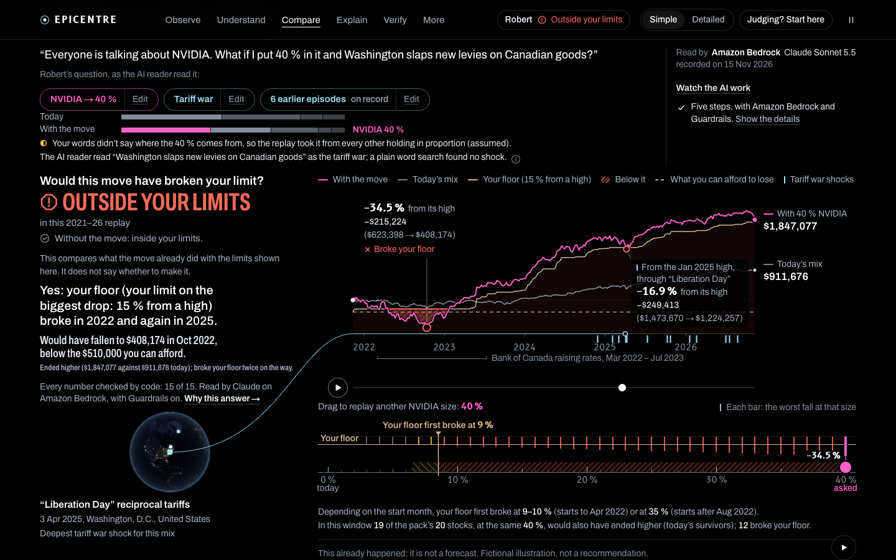

<!--
One-pager (lane D2's text, set by lane pdf on Sun 15 Nov as a one-page spec sheet; the Replay rulings bind every word).
The case's six blocks in its own order (problem, agentic approach, originality, data sources, explainability, user
benefits), one hero image, at most six figures (ruling R22). No number is typed: every slot (in angle brackets) is filled
by scripts/fill_docs.py from the final saved runs (data/demo_runs) and this template (docs/templates/one_pager.md) into
docs/one_pager.md, and scripts/render_pdfs.py prints that filled file, failing past one page or past six figures. Edit the
template, never the filled file.
-->
# EPICENTRE

**Crash-test your move before you make it.**

« Passez votre placement au crash-test avant d'agir. »

See whether it would have stayed inside your own limits, replayed through real 2021–26 market shocks: the 2022 stock-and-bond fall and sourced geopolitical and rate shocks, on daily prices. Robert's answer: **Outside your limits, in this 2021–26 replay.**

Robert's replay at its end frame. This already happened; it is not a forecast. Fictional illustration, not a recommendation.

## The problem

Most AI investing demos recommend a trade. An order-execution-only broker such as National Bank Direct Brokerage may not; EPICENTRE shows what the move already did, against the investor's own limits. Robert, the case's fictional investor, is close to retirement. Everyone is talking about NVIDIA; he is about to put 40 % of his portfolio in it. Nothing at the order shows him what such a move already did.

## The agentic approach

Five visible steps: Observe, Understand, Compare, Explain, Verify. Claude Sonnet 5.5 on Amazon Bedrock does the two language jobs: the **navigator** reads free words or a headline into a move, a shock family and sourced precedents (it asks for a missing limit and abstains without a precedent), and the **debrief** explains. Code computes every number and every check and writes the verdict; a **receipt** checks each number of the explanation before it is shown. Bedrock Guardrails screen the question.

## What is original

Ending higher does not mean your limits held: with the move, Robert ended higher, yet his floor broke on the way. The shock is the thread, lit at its epicentre on a night globe, then on his chart, then under the verdict. *Where it breaks* names the size at which the past first broke his floor, 9 % NVIDIA in this replay, never an acceptable size. AI off: no verdict changes; the question checked does.

## Data sources

The organizers' starter set: Yahoo Finance daily prices, Bank of Canada exchange and policy rates, FRED. Sourced shocks, each with its link and date; the screened fund's published exclusions; issuer ETF holdings (local, never redistributed); public index series for the crises before 2021. Nothing dated after the decision reaches a tool. Limits: one regime in five years; shocks chosen with hindsight; nominal CAD, no taxes or fees.

## Explainability

Every number on the page is a button: its facts row, the trace step that computed it, the data rows behind it, and Recompute, which re-runs its own tool with no model. Each sentence carries ● fact, ◐ assumption or ○ fiction. Robert's receipt traced 15 of 15 numbers to tool output. The navigator is scored against keyword rules on blind held-out questions, each rate with its Wilson interval.

## What the user gains

Robert sees the move against his own limits, in dollars, before acting: its worst fall took his money down to $408,174, past the $90,000 he could afford to lose (assumed). He may keep a sealed record: edit one number and the seal breaks. National Bank Direct Brokerage could offer it beside the order ticket, a checkpoint, not a stop sign. Shown on every order, at the client's click, never triggered by the order; designed to make no recommendation, subject to the broker's compliance review. Pilot measures: records kept, risk understanding, complaints; never trades.

---

**Static demo**, public, no AWS call: [shmorsi.github.io/poly-datathon-2026](https://shmorsi.github.io/poly-datathon-2026/) · **Live app on AWS**, with the password from the submission form, until the AWS account closes: [dqetfenyawfe9.cloudfront.net](https://dqetfenyawfe9.cloudfront.net) · **Code**: [github.com/shmorsi/poly-datathon-2026](https://github.com/shmorsi/poly-datathon-2026)

*Educational simulation. This is not financial advice.*
