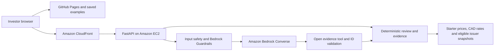

# EPICENTRE | Portfolio X-ray

Technical notes · PolyFinances Datathon 2026 · AlphaForge AI

**In one paragraph.** EPICENTRE measures the portfolio as it stands and replays a user-defined change against the same historical market period. It exposes fund coverage and portfolio risk sources, explains where each metric comes from, and lets the investor request an explanation focused on an existing piece of evidence.

## 1. Workflow and architecture

The workflow starts with existing holdings and an investor’s loss limit. National Bank Direct Brokerage is the reference brokerage for this educational prototype.

| Component | Role |
| --- | --- |
| `web/review.html` | Positions, Money and Risk lenses, dated ETF exposure, replay and evidence. Saved examples cover Robert, Mateo, Amira and Too Canadian? |
| `POST /api/review` | Validates positions and optional limits, simulates a funded change and calculates CAD paths, risk and full before-and-after allocation. |
| `POST /api/review/explain` | Accepts a review reference and goal. One Bedrock Converse call can use `open_evidence` to select up to three distinct calculated cards. |
| Saved static walkthrough | Shows rounded weekly paths, approved industry aggregates and coverage. Authenticated live use can show named ETF holdings from eligible issuer snapshots. |

**Estimated cost.** The event hosting estimate is about US$1.10 for 39 hours of one EC2 instance, EBS volume and public IPv4 address. With 1,200 assumed input tokens and a 512-token output cap, one evidence-selection call would cost about US$0.0083 at the dated US inference profile rates. Guardrails charges depend on text units. The public walkthrough makes no model calls. [Hosting assumptions](https://github.com/shmorsi/poly-datathon-2026/blob/main/docs/deploy.md#9-cost-estimate) · [Dated AWS price evidence](https://github.com/shmorsi/poly-datathon-2026/blob/main/docs/aws_evidence/07-price-list.json)

## 2. Calculation methods

**Positions and financing.** Enter a fictional value in CAD and holdings that total 100%. Drawdown tolerance, loss capacity, a crypto cap and the values screen are optional. Presets use illustrative values. An order sets a target allocation funded by one selected holding or proportionally across the other holdings.

**Daily path.** The organizers’ starter set covers November 12, 2021 to November 12, 2026. The review aligns adjusted closes and converts USD-denominated lines using the Bank of Canada USD/CAD rate series. Both paths start with the same account value. The model rebalances to fixed weights daily. Wealth changes and their drawdowns are computed before fees, taxes and inflation. The chart distinguishes a fall from the running high from an absolute CAD balance floor based on the starting account value and entered dollar loss capacity.

**Risk lens.** The money weight is the fraction invested. Risk share allocates historical portfolio variance using the covariance of daily CAD returns. Multiply a holding’s weight by its covariance with the portfolio, then divide by portfolio variance. Volatility and correlation can make the modeled contribution larger than the money weight. A diversifying holding’s contribution can be negative. Individual risk shares use held securities and funds as portfolio lines. Sector and company look-through shows economic exposure in the Money lens.

**ETF exposure.** The full allocation comparison includes asset types and equity industries. A fund’s industry exposure equals its portfolio weight multiplied by the industry’s fund share. Where disclosed data is available, company exposure combines direct and ETF holdings. Sources, dates and coverage distinguish reported holdings from unavailable exposure. The holdings snapshot describes present-day exposure. The replay uses historical fund prices.

## 3. Explanation and controls

The calculation creates evidence cards with comparisons, units, methods and provenance. The optional Bedrock Converse call receives the user’s focus and card IDs and labels. The server accepts up to three distinct allowable IDs and displays their computed text. Portfolio inputs and price or issuer rows are omitted from the model request. The goal is screened for account details and advice requests. A rules-based selector can return evidence when Bedrock is unavailable or its response fails validation.

A review reference must correspond to an existing calculation. The prototype simulates orders in application state without a brokerage integration or execution path. The project’s classic deployment documents password-protected CloudFront and EC2, Guardrails and a least-privilege IAM role. [Classic AWS configuration and evidence](https://github.com/shmorsi/poly-datathon-2026/blob/main/docs/aws.md)

## 4. Evidence example

In Robert’s recorded example, XIU represents 45% of money and 71.1% of historical risk. With a hypothetical 40% NVIDIA allocation, Robert’s balance falls to $408,174 CAD and spends 188 market sessions below his assumed $510,000 CAD floor. The fictional starting balance is $600,000 CAD and his loss capacity is $90,000 CAD. The public path is rounded. [Calculation methods](https://github.com/shmorsi/poly-datathon-2026/blob/main/docs/finance_methods.md)

For a holdings example, open XIU’s Financials exposure. The saved issuer snapshot reports 41.23% of the fund in Financials. Multiplying by Robert’s 45% fund weight gives approximately 18.55% of the whole portfolio. The holding date, coverage and issuer link let the user inspect this result. [XIU issuer page](https://www.blackrock.com/ca/investors/en/products/239832/ishares-sptsx-60-index-etf)

## 5. Reproduction and validation

Use the release checkout. Install the Python dependencies, put the organizers’ starter set in `data/starter/`, run `EPICENTRE_NO_BEDROCK=1 uvicorn server:app --host 127.0.0.1 --port 8000`, then open `/review.html`. Put a permitted issuer snapshot in `data/etf_holdings.csv` to enable company detail. For Bedrock, apply the AWS configuration in the runbook. [Runbook](https://github.com/shmorsi/poly-datathon-2026/blob/main/docs/deploy.md)

The review API checks cover same-base historical paths, single-holding funding limits, combined direct and fund exposure, a baseline-only request and rejection of an unknown evidence reference. Frontend checks cover weight parsing, funding validation, drawdown from a running high and ticker identification. The saved view can be inspected separately to confirm it carries only the public cut. [Python checks](../tests/test_order_review.py) · [Browser logic checks](../tests/test_review_frontend.mjs)

## 6. Limitations and next steps

The replay covers a limited set of market conditions and depends on the selected weights and rebalancing policy. Issuer snapshots can omit underlying companies. Future work could extend asset and snapshot coverage and measure usability at the brokerage order ticket.
