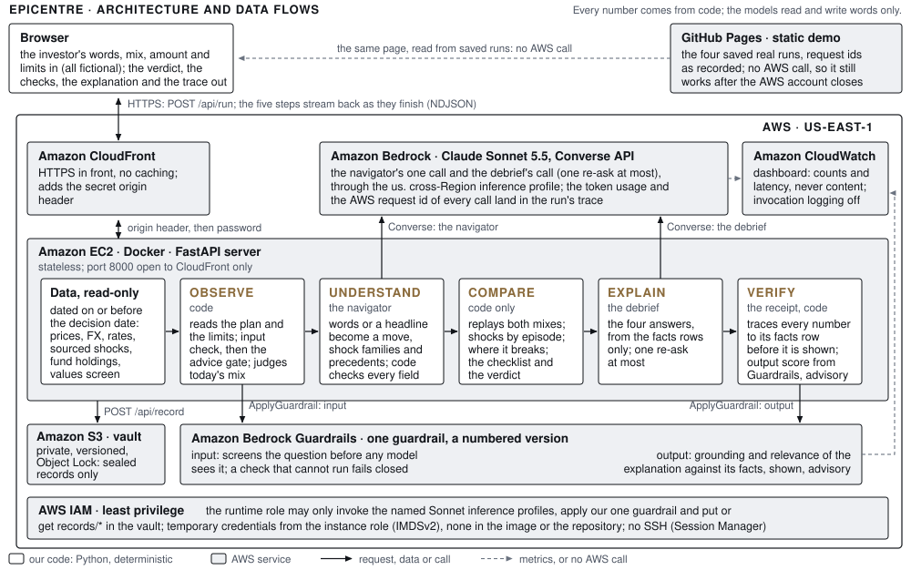

<!--
Technical documentation (lane D1, Sun 15 Nov; the Replay rulings R1-R16 bind every word). About nine pages as a PDF once filled.
No number is typed: every number is a run slot or an eval slot (in angle brackets), filled by scripts/fill_docs.py from
the final saved runs (data/demo_runs) and docs/eval_results.json, from this template (docs/templates/technical.md) into
docs/technical.md. Edit the template, never the filled file.
-->
# EPICENTRE: technical documentation

**Crash-test your move before you make it.** See whether it would have stayed inside your own limits, replayed through real 2021–26 market shocks.

PolyFinances Datathon 2026 · AlphaForge AI · [README](../README.md) · [AWS architecture](aws.md) · [Evaluation](eval_results.md) · [Finance methods](finance_methods.md) · [Receipt mutation test](receipt_mutation.md)

**In one paragraph.** An investor is about to act on a tempting move. Robert asks: "Everyone is talking about NVIDIA. What if I put 40 % in it and Washington slaps new levies on Canadian goods?" Before the order, EPICENTRE replays the move on real daily history, Nov 2021 to Nov 2026, through the 2022 stock-and-bond fall and 37 sourced geopolitical and rate shocks; it checks today's mix and the mix with the move against the investor's limits (capacity for loss, horizon, concentration, values; assumed for the four fictional investors) and answers *Inside your limits*, *Inside, with caveats* or *Outside your limits*, always "in this 2021–26 replay", in dollars. One agent reads the words (the navigator), code computes every number and every check, a second agent explains (the debrief), and code checks every number of the explanation before it is shown (the receipt). This already happened; it is not a forecast.

| The case asks the technical documentation for | Where |
|---|---|
| The overall logic, the roles and interactions of the agents, the controls and governance checks | [1](#1-the-overall-logic) · [2](#2-agents-roles-and-controls) |
| The methods, models and technologies, and why they were chosen | [3](#3-methods-models-and-technologies-and-why) · [aws.md](aws.md) |
| Sources, selected assets, data processing, assumptions | [4](#4-data) |
| The explainability mechanism, and an example from a conclusion to the data and the execution trace | [5](#5-explainability) |
| Validation of results and explanations, limitations, improvements | [6](#6-validation) · [7](#7-limitations) · [8](#8-improvements) |

## 1. The overall logic

**The question.** In the seconds before a self-directed investor confirms a move: *did a move like this stay inside the limits I set, the last times shocks like the one I fear hit?* EPICENTRE is decision support, not a forecast, an optimiser or advice: it never proposes a security or a size, and it never reads an account. Its thesis: ending higher does not mean your limits held. Robert's saved run shows why (a fictional profile). With the move, his money ended higher, $1,847,077 against $911,676 for today's mix; on the way it fell from $623,398 to $408,174 (34.5 % from its high), past both of his limits, each assumed for this fictional profile: his tolerance, no fall of more than 15 % from any high, and his capacity, the $90,000 he could afford to lose (it went below $510,000 for 188 sessions). It broke the 15 % rule in 2 separate falls. The verdict: **Outside your limits, in this 2021–26 replay**; without the move, Inside your limits.

**One run, five steps.** National Bank's workshop method, Observe, Understand, Compare, Explain, and one step we added: Verify (ruling R19). Each step streams to the page as it finishes (NDJSON), and every tool call and model call is a row of the run's trace, with its service, model, milliseconds, tokens and AWS request id.

| Step | What happens | Who does it | In Robert's saved run |
|---|---|---|---|
| OBSERVE | Read the plan (weights, fictional amount, the limits, assumed or typed); screen the question before any model sees it; judge today's mix | Code; Amazon Bedrock Guardrails (input) | Input check 546 ms, action NONE |
| UNDERSTAND | The words, or a pasted headline, become a validated move, shock families and sourced precedents, or one clarifying question | The navigator: Claude Sonnet 5.5, one Converse call over searches code already ran; code validates every field; the keyword rules answer on any failure | 2,224 ms, 2,986 tokens in, 281 out |
| COMPARE | Replay today's mix and the move on the same days; shocks by family and episode; risk share; the size curve (where it breaks); the checklist and the verdict | Code only | 8 checks; 41 sizes judged |
| EXPLAIN | Write the four answers the finance workshop asks for (what data, why this verdict, what limits, what would change the answer) from the facts rows only | The debrief: Claude Sonnet 5.5, one Converse call with a JSON schema, at most one re-ask | 5,244 ms; drafts: 1 |
| VERIFY | Trace every number of the explanation to its facts row and name each defect; show the grounding score, advisory | Code (the receipt); Amazon Bedrock Guardrails (output, advisory) | 15 of 15 numbers traced |

**Architecture.** One stateless API and one static page; two AWS services do real work (Bedrock and Guardrails), the rest serves and protects them ([aws.md](aws.md)).

White boxes are our code, grey boxes AWS services. One run's two model calls cost $0.0452 at list price, an estimate (Bedrock bills separately); the guardrail units, the live window and the account's own bill are in [aws.md](aws.md) (Cost).

**Four investors, four deciding checks.** The case's personas, plus the finance workshop's own question. Each card is decided by a different check, so none is a copy of another.

| Investor (fictional) | Saved question | What the persona tests | Verdict, in this 2021–26 replay | Decided by |
|---|---|---|---|---|
| Robert | Everyone is talking about NVIDIA. What if I put 40 % in it and Washington slaps new levies on Canadian goods? | Challenging a request that conflicts with his profile | Outside your limits | Your floor |
| Mateo | I care about my values: does my portfolio own companies with major controversies, and what if an oil shock came from the Middle East? | Weighing more than return and risk | Outside your limits | Values |
| Amira | What if the US–China chip war heats up again? | "High risk" is not "anything goes" | Inside, with caveats | Crypto share |
| Too Canadian? | My portfolio seems very Canadian. Would adding 20 % SPY improve my diversification? | The workshop's question (SPY stands in for XSP, which the data set lacks) | Inside your limits | No limit broke (Risk concentration is a caution). More spread, not softer: worst fall 11.9 % → 12.9 % (14.2 % hedged like XSP) |

## 2. Agents, roles and controls

The organizers' deck asks of every agent: *why does it exist and what value does it bring?* EPICENTRE has two agents, one per language job, and deterministic code around them. No multi-agent framework: the case says the number of agents is not the goal, and the technical workshop's level 8 asks that code own the loop.

| Part | Why it exists | Reads → returns | May not | When it fails |
|---|---|---|---|---|
| **Navigator** (Claude Sonnet 5.5, `agents/scenario.py`) | Free words, slang, French or a headline must become a validated move, shock families and sourced precedents, or one clarifying question | The question, the plan, three read-only searches code already ran → one JSON plan | Compute a number; name an event code did not list; narrow the evidence | The keyword rules answer in the same shape, and the page says why |
| **Read-only tools** (`search_events`, `propose_change`, `get_exposure`) | Evidence the model chooses among, ranked by code | The catalogue cut at the decision date, the plan, the move → ranked precedents, the move on a copy, look-through exposure | Write anything | A plain error sentence |
| **Replay and checklist** (`tools/`, `governance.py`) | Every number and the verdict | Weights, history up to the decision date, the limits → series, metrics, shocks, checks, verdict | Call a model | A plain sentence; no limits, no verdict |
| **Debrief** (Claude Sonnet 5.5, `agents/explainer.py`) | Facts become plain English the investor can check | The facts rows, the verdict, the failed rules, the caveats → four sections, each number citing its [T#] | Add a number, a date, an event or advice | Re-asked once with the defects named; then shown flagged or withheld |
| **Receipt** (`verify.py`) | Proves the debrief is faithful | The sentences and the facts rows → each number traced, or a named defect | Pass a number it cannot trace | A number defect is shown in red |
| **Guardrails** (`guardrail.py`) | A screen on the way in, a second look on the way out | The question; the explanation and its facts → blocked, or scored | Block the explanation (advisory) | An input check that cannot run fails closed |
| **Keyword rules** (`keyword_fallback`) | The fallback, and the baseline the navigator must beat | The question → the same plan shape | Read a move the words do not state | Asks one question instead of guessing |

**What the model chooses, and what code decides.** The navigator chooses only what needs language: the kind of question, the move as written, the families of a headline, which of code's ranked precedents fit, and when to ask. Code decides the rest: every number, the order of the checks, the size curve, the reasons shown for picked and set-aside shocks, and every validation (event ids known at the decision date, tickers in the universe, the move cross-checked against the words). The debrief chooses words only; code builds its references and disclaimer and sets each sentence's marker (● fact, ◐ assumption, ○ fiction) from the rows it cites.

**Engines and budgets.** The navigator makes one Converse call over tool outputs code already computed. A bounded loop in which the model picks the next read-only tool (turn and call caps in `config.py`, each call validated and traced) is an evaluation arm: it read the families about as well on the development set (38 / 40 against 37 / 40) but was slower, so the product keeps one call and claims no model-chosen tool call. The debrief makes one call and at most one re-ask; Guardrails check the question once and the shown explanation once; a step deadline and a run deadline bound every call.

### Controls and governance checks

The case asks for checks that an action respects the investor's constraints and the simulation-only boundary, that conflicts and missing information are flagged, and that the controls are visible. Governance here is code, not a third agent: a rules engine cannot be talked out of a limit. No account is ever read (decision support, not a suitability assessment). For the four fictional investors, the limits are assumed from the profile's risk band (`data/personas.json` over `config.py`, read by `governance.load_limits`; the floor from the loss the profile is assumed to absorb, when that is tighter); only the limits a user types in the live app's editor are typed by the user. The page labels the first "assumed for this fictional profile", and *Edit your limits* in `#checklist` judges the same run again on the second.

| Control | What it checks | If it trips |
|---|---|---|
| Input guardrail | A request to tell someone to trade a specific real security; prompt attacks; personal data | The run stops before any model, with one plain sentence |
| Navigator validation | Event ids known at the decision date; tickers in the universe; valid families; the move against the words | The keyword rules answer; the reason is shown |
| No look-ahead | Every row dated after `as_of` is cut before any computation; an event counts only once its window is complete | The scramble test must show the same seal ([6](#6-validation)) |
| The checklist | `max_drawdown`, `scenario_stress`, `single_stock`, `sector`, `crypto`, `esg_direct`, `esg_indirect`, `risk_concentration`, `recovery`, `short_horizon`, `missing_data`, in tiers hard (the floor; with the values screen on, a company owned directly that it excludes), soft, preference and warn (a flag inside a fund); compared after ROUND_HALF_UP rounding | A hard fail: Outside your limits. A soft or preference fail, a caveat, or two or more warnings: Inside, with caveats. Otherwise Inside your limits. Unknown is never a pass |
| Abstention | An unknown ticker; an amount with no value; no close precedent; too few clean episodes | One clarifying question, "no close precedent at this date" or "too few shocks to conclude" (Can't say) |
| Receipt | Value, unit, entity, kind, direction and side (today or after the move) of every number; dates after `as_of`; the verdict words; the failed rules; advice and forecast words | One re-ask with the defects named; a number defect that remains is flagged; advice that remains withholds the explanation, and the numbers stay |
| Output guardrail | Grounding and relevance of the explanation against its facts (threshold 0.7) | Shown in VERIFY, advisory: scored against the facts written as plain sentences, a clean explanation is above the threshold but so are most known-gap copies (eval section 8), so the receipt is the gate |
| Wording | "Inside / outside the limits you set", never buy, sell, hold or "you should"; "Fictional illustration, not a recommendation." on a fictional mix; the disclaimer at the end of every answer, appended by code if missing | Receipt, tests, input guardrail |

### The technical workshop's ten levels, as built

| Level | The workshop | What EPICENTRE does | Evidence |
|---|---|---|---|
| 1–4 · Instructions, scoped rules, a specialized agent, skills | Name the case; one rule per file; one trade with limited tools; procedures on demand | How the build ran, not product features: a locked spec, named pitfalls, scoped rules, a read-only reviewer agent and task procedures guided every coding agent (internal, not part of this submission) | this document |
| 5 · A template and a script | Code counts; no number from memory | Code computes every number and the debrief cites its row; every number in these docs is filled from the saved runs | `governance.py`, `tools/`, `scripts/fill_docs.py` |
| 6 · A guardrail that blocks | Block and tell | Bedrock Guardrails and the code advice check stop a request before any model, in one plain sentence | `guardrail.py`, `advice_guard.py` |
| 7 · A brigade | Nobody grades their own dish | The model writes; code checks every number against its facts row, and the page shows the count | `verify.py`, `tests/test_verify.py` |
| 8 · A scripted pipeline | Code holds the loop; abstain, never invent | Five fixed steps, 25 s per model step, at most one re-ask; a clarifying question, "no close precedent" or Can't say | `pipeline.py`, `tests/test_pipeline.py` |
| 9 · Maintenance that corrects itself | Name the defect; every fix ships a test | The receipt names each defect and the debrief is re-asked once with those lines; CI re-runs the offline suite on every push | `pipeline.py`, `.github/workflows/tests.yml` |
| 10 · A memory that names, and the proof | Yesterday's defect opens today's run, measured | The defect types of earlier runs (types only) open the next debrief prompt; measured with and without, no gain beyond noise | `agents/memory.py`, [eval_results.md](eval_results.md) §10 |

## 3. Methods, models and technologies, and why

Exact definitions and every tolerance are in [finance_methods.md](finance_methods.md); this is the reasoning.

| Method | What it does | Why this, and not something else |
|---|---|---|
| Constant-weight replay in CAD | Rebalanced to the target weights every session, base 100, on adjusted closes (total return); USD lines at that day's USD/CAD | The weights the rules check are the weights the drawdown measures: one definition everywhere. Re-judged with shock dates one session earlier or later and a later start (finance_methods.md §8); the other method variants are not yet measured |
| The floor, a fall from any high | The stricter of the risk band's floor and the capacity floor (the loss the investor said they could absorb over the amount); drawdown against the running high | Risk tolerance (willingness) is not risk capacity (ability), the finance workshop's own distinction. Robert's capacity binds: a 15.0 % fall, $90,000 on $600,000 |
| Dollars from the path | Each fall in the money's own dollars, at its high and at its low (`breaches[i].peak_value`, `trough_value`) | A fall from a later, higher value keeps its own dollars; the capacity is a second limit, not the 15 % rule |
| Shocks by episode | 37 sourced announcements in four families (tariffs, war and oil, chips, rates); same-family events whose windows overlap form one episode; an episode is mixed when another family's event falls between its start and its low | Counting overlapping events separately would overstate n; the page shows n and an evidence level (Measured, Indicative, Can't say) |
| Risk share and independent bets | Each line's share of the portfolio's variance (Euler contributions) and the effective number of bets (Meucci) | Diversification means varying sources of risk, not more names: with the move, NVIDIA is 40 % of Robert's money and 90 % of its risk |
| Look-through | Direct holdings plus each fund's holdings × its weight; exposure only, coverage disclosed per fund | The same company sits in several funds; unknown is never a pass |
| Where it breaks | The move's size in whole-percent steps up to the asked size, each judged by the same checklist; the first size judged Outside | Shows where the investor's own floor first broke in this history; never a target, never an acceptable size |
| Earlier crises by stand-in | Sourced crises before the starter data, replayed monthly on public index stand-ins, checked against the real engine where both exist ([4](#4-data)) | Five years hold one regime; the card is a disclosure (◐), probably milder than the real thing, never the verdict |

**Models.** Both language jobs run on Claude Sonnet 5.5 on Amazon Bedrock (`us.anthropic.claude-sonnet-5-5`, the `us.` cross-Region inference profile, Converse API, us-east-1). The navigator must turn French, slang, typos and headlines into a strict JSON plan that code can validate, and on the blind held-out prompts 13 questions only the AI reader got right, 0 the other way (exact McNemar p = 0.0002; [6](#6-validation)). The debrief uses Converse's JSON-schema output, so its sections and [T#] references arrive as structure. Claude Haiku 5.5 is wired as the evaluation's comparison model, but the per-job comparison was not run in the published measurement ([eval_results.md](eval_results.md) §9): we claim no saving from a smaller model and keep Sonnet 5.5 for both jobs.

**Request settings.** Thinking `between_tools` and effort `low`; never `temperature`, `topP` or a forced tool choice (Sonnet 5.5 answers HTTP 400 to them); a token cap per job and adaptive retries with explicit timeouts (`config.py`). Each call marks a cache point after its static prompt, and the cache is used: Robert's saved trace shows 0 navigator and 0 debrief tokens read from the cache. His two model calls cost $0.0452: an estimate at Anthropic list price, list price as of 2026-10-06 (Anthropic's published model price table; per million input / output tokens: Sonnet 5.5 $2.00 / $10.00, Haiku 5.5 $0.10 / $0.50; cache read 0.1 x, cache write 1.25 x input); Bedrock bills separately.

| Technology | Its job | Why it was chosen |
|---|---|---|
| Amazon Bedrock (Converse) and Bedrock Guardrails (`ApplyGuardrail`) | The two language jobs; the input screen and the output score | Managed models behind one API, with token usage and a request id per call (they land in the trace) |
| Python 3.12, pandas, numpy | Every number | Deterministic and testable offline on synthetic data with known answers; no model sits in the number path |
| FastAPI and uvicorn | A stateless API: `POST /api/run` streams the five steps as NDJSON; `POST /api/recompute` re-runs one number; `POST /api/record` stores a sealed record | Typed validation of the plan (pydantic), streaming, errors as one plain sentence |
| HTML, CSS and plain ES modules; three.js and SVG, vendored | The page: the night globe, the race chart and its size ruler, the checklist, the evidence drawer | No build step, no framework, no network needed for the demo; licences in `web/vendor/LICENSES.md` |
| Docker on EC2 behind CloudFront; saved runs and a static build | The live app; the permanent demo, with no AWS call | One non-root image with no secret inside and the licensed data mounted read-only ([aws.md](aws.md)); the static demo works when AWS is off (the finalists' pitch, a phone) and shows request ids as recorded, never as live |

## 4. Data

Each dataset with what it holds, its dates, its processing and its terms; the full lineage (sizes, retrieval dates, every correction and its test) is in [finance_methods.md](finance_methods.md) §2 and Appendix A.

| Dataset | What and when | Processing | Terms |
|---|---|---|---|
| Starter pack (`data/starter/`) | The organizers' set: Yahoo Finance daily prices in the listing currency, Bank of Canada USD/CAD, Bank of Canada and FRED rates, dividends and splits; daily, 12 Nov 2021 to 12 Nov 2026 (the saved runs keep a weekly cut of each series) | Adjusted close (a total return); one correction (the pack counts a 2022 special distribution of CNQ.TO twice; a test pins the fix); the union of TSX and US sessions; short gaps carried forward, longer ones flagged; USD × the last Bank of Canada rate, never back-filled; of the macro file only the policy rate is used | Free within the datathon; redistribution unclear, so never committed. Read with pandas only; our code never runs its build script |
| Shocks (`data/events.csv`) | 37 announcements since Feb 2022 in four families, each with a source URL and a verification date | Dated to the first session after the announcement; an inclusion rule written before any price was looked at | Our own summaries with source links; committed |
| Values screen (`data/esg_flags.csv`) | The ESG-screened fund's published exclusion categories; a controversy flag only where a company's own filing discloses a proceeding, under a written significance rule | Dated by source; no disclosure, no flag; an exclusion screen, never a score | Our own work with short cited quotations; committed |
| Fund holdings (`data/etf_holdings.csv`) | The issuers' files: top holdings, sector and country splits; one snapshot | Exposure only; coverage disclosed per fund; a past decision date uses direct holdings | Issuers forbid redistribution: local only, rebuilt by `scripts/fetch_holdings.py`; a fresh clone uses direct holdings and says so |
| Earlier crises (`data/deep_episodes.csv`, `data/deep_proxies.csv`, `data/cache/deep/`) | 11 named crises between 1973 and 2021, each sourced; a monthly panel to Dec 2025 from the Kenneth French Data Library, Statistics Canada tables 10-10-0122-01 and 10-10-0125-01, FRED USD/CAD and World Bank gold | `scripts/fetch_deep.py` records URL, time, SHA-256 and licence per file; monthly total returns in CAD; a missing month stays missing (Can't say). Canada is the TSX before Jan 1977, Fama/French Canada after, in CAD | Statistics Canada Open Licence; World Bank CC BY 4.0; FRED public domain; the French library states no licence, so its raw files stay local |
| Investors (`data/personas.json`) | The case's personas and the workshop's question: fictional amounts, mixes and limits | Read through `governance.load_limits`; an edited limit overrides the starting value | Our own work; committed |
| The night Earth (`web/vendor/nasa/`) | NASA Earth Observatory, Black Marble 2016 (Suomi NPP VIIRS), the "Earth at Night" flat map of image record 144898 (`BlackMarble_2016_3km.jpg`), downloaded 2026-11-15 | One Lanczos resample to two sizes (desktop and phone), progressive JPEG; drawn in linear light with a thin atmosphere; the hero posters are renders of that globe. A picture only: no number comes from it | NASA imagery, public domain; credit NASA Earth Observatory; NASA does not endorse this project ([web/vendor/LICENSES.md](../web/vendor/LICENSES.md)) |

**Selected assets.** The pack's universe as given: Canadian and US stocks, stock and bond funds (the ESG-screened fund among them), a short-term fund that stands for cash, gold, Bitcoin and Ether. The question needs exactly these kinds, and the case makes no asset mandatory. SPY stands in for the workshop's XSP, which the pack lacks; real estate, savings accounts and GICs are outside the universe.

**Time consistency.** A shock is dated to the first session after its announcement; monthly macro rows carry their reference month, so no verdict uses CPI; a controversy flag carries its source date; holdings are one snapshot. Every row dated after `as_of` is dropped before any computation. The one exception is the question, which may quote today's headline: it is matched against history, never used as evidence for a number.

**Assumptions** (◐ on the page): constant weights rebalanced daily; no trading costs or taxes (fund prices carry their fees); nominal returns in Canadian dollars, before inflation; the shock and recovery limits as fractions of the floor and of the horizon (`data/personas.json`); the personas' limits; the stand-in mapping.

**The stand-in method, and its limits.** Each held asset maps to a public stand-in (`data/deep_proxies.csv`): a Canadian bank becomes the Canadian market, NVIDIA the US chip industry, a bond fund the Government of Canada bond ladder, gold the World Bank monthly price; Bitcoin has none, so a mix holding it reads Can't say. Both mixes are replayed month by month through each crisis against the verdict's own floor definition. Before any deep number shipped, the stand-ins were run beside the real engine: over Nov 2021 to Dec 2025 they replay Robert's mix today within 1.9 points of its real fall, but fall 18.6 points short for the move, because one company fell much further than its industry (from Nov 2021, NVIDIA fell 60.2 % and the chip industry 27.0 %). So the card is probably milder than the real thing; a month-end series also hides a fall that recovers inside the month; a break within one point of the floor reads "touched", not "broke"; and the card never enters the checklist or the verdict. Its line is written by code from the episodes, for example Robert's: "By proxy, in the 11 earlier crises: with 40 % in the US chip industry, your mix broke your floor by 5 to 35 points in 1974, 1987, 2002 and 2009; it fell no further than your mix today in the rate shock (1994). Your mix today held in 8 and came within reach of your floor in 3 (1974, 1982 and 2009): too close to call." This already happened; it is not a forecast.

## 5. Explainability

The case wants explanations that are concise, verifiable and faithful to the sources and to the observable actions, without exposing a model's internal reasoning. The mechanism has seven parts, each visible on the page.

1. **Facts.** Every number on the page is a facts row (id [T#], label, value, unit, entity, sign, kind). The kind is the marker: ● fact (computed from data), ◐ assumption (a limit, a rule, a stand-in), ○ fiction (the investor, the amount, the move). Robert's run holds 249 rows.
2. **Trace.** Every step, tool call and model call is a trace row (tool, inputs, outputs, source, as of, milliseconds, service, model, tokens, request id) in the facts' id space: a fact's id is the id of the row that computed it. It holds tool calls and their outputs, never a model's reasoning (Robert's run: 282 rows).
3. **Explanation.** The debrief answers the finance workshop's four questions, one section each (what data, why this verdict, what limits, what would change the answer); every number cites its rows, and code sets each sentence's marker from them.
4. **Receipt.** Code checks each number's value, unit, entity, kind, direction word and side against its row, names advice and forecast words as defects and re-asks once; the page shows how many numbers were traced.
5. **Check it yourself.** Every number is a button. The evidence drawer shows its facts row, its trace step, the data rows behind it (the public cut: the portfolio's own values on the fact's dates; licensed prices are never published) and **Recompute**: `POST /api/recompute` re-runs that number's own tool from the run's inputs, with no model, and says whether the stored value came back.
6. **The navigator, switched off.** The keyword rules' reading of the same words sits beside the navigator's, with what changed (`navigator_effect`). In Robert's run the two readings differed in their families; the verdict read *Outside your limits* with the navigator and *Outside your limits* without it. The page shows the real difference, never a claimed one, and where the keyword rules misread a wording it can show the evaluation's held-out cases, labelled as such.
7. **The decision record.** The page ends on one card the investor may keep: the move, the limits and who set them, both verdicts and both outcomes, the deciding checks, every number with its source, the data version and a SHA-256 seal of the canonical record; edit any number and the seal visibly breaks. It downloads as JSON or prints; in the live app "Keep a sealed copy" stores it in the private record vault ([aws.md](aws.md)), the only input the project ever stores.

### One number, all the way down

Robert's saved run 8882af8010ef, decided with data up to 12 Nov 2026. One sentence of the explanation, followed to the rows it rests on.

| Link | What it is | In the saved run |
|---|---|---|
| 1. The sentence | The debrief's own words, as the page shows them | "The portfolio after the move fell 34.5 % [T32] at its worst." |
| 2. The facts row | The row the sentence cites | T32, "Worst drop after the move": −34.5 %, entity after, kind fact (●) |
| 3. The trace row | The same id: the step and the tool that computed it | Step COMPARE, tool governance.evaluate, path metrics.after.max_drawdown, service Python |
| 4. The computation | `tools.portfolio.portfolio_series` on the weights with the move (base 100, CAD, rebalanced daily), then `tools.metrics.risk_metrics`: the fall against the running high | From the high of 29 Nov 2021 to the low of 14 Oct 2022 |
| 5. The data rows | What the evidence drawer lists for this fact: the portfolio's own value on the two dates | 29 Nov 2021: 103.90; 14 Oct 2022: 68.03. The drop is the later value over the earlier one, less one: redo it by hand |
| 6. Recompute | `POST /api/recompute` with the run id and the fact id re-runs the recipe (evaluate.after) from the run's own inputs; no model is called | The same value comes back; `tests/test_pipeline.py` pins it on the starter data for this fact |
| 7. The dollars | A real fall applied to a fictional amount, so its own row is ○ fiction | $207,146 on $600,000, tool "amount × drawdown", kind fiction |
| 8. The receipt | The sentence passes only if each number equals its cited row, names the row's entity and fits its kind | 15 of 15 numbers traced; defects named: 0 |
| 9. The model call | The debrief's call that wrote the sentence | us.anthropic.claude-sonnet-5-5, request id 2a688af2-e498-44c2-abca-bdc97596ffe4, recorded on Bedrock when the run was saved (shown as recorded, never as live) |

The self-correction is visible the same way: when a draft carries a wrong number, the receipt names the sentence and the defect, the debrief is re-asked once with those lines, and both drafts stay in the trace. This already happened; it is not a forecast.

## 6. Validation

Results and explanations are validated separately. Every rate is k / N with its Wilson 95 % interval, the model, the date and an evidence level: Measured at N of 30 or more, Indicative below.

**The numbers.**

| What | How | Result | Level and limit |
|---|---|---|---|
| Against the issuers | Our returns from the dataset's adjusted closes beside the funds' own published returns, same period and basis | 5 of 5 within 0.15 pp (table below) | Indicative (N below 30), read on the issuers' pages; a shared method error would not show |
| Recompute | Each number's own tool re-run from the run's inputs ([5](#5-explainability)) | The stored value comes back, pinned by `tests/test_pipeline.py` on the starter data | One run's numbers, not the method |
| No look-ahead | `tests/test_data.py` scrambles every row after `as_of` and requires identical tables; the sealed envelope (`proofs.seal`, `scramble_future`) re-runs a decision on a copy whose later dates are re-dealt, and a leaky control must change the seal | Same seal | The data path only: not a model's memory, nor the holdings, values, deep or release-date files |
| The concentration ladder | The same 40 % in the broad US market, the Nasdaq-100 fund and NVIDIA, judged by the same checklist on 2021–26 data | Against a 15.0 % floor, the worst fall was 14.2 % in the broad market (*Inside, with caveats*), 18.4 % in the Nasdaq-100 fund (*Outside your limits*) and 34.5 % in NVIDIA (*Outside your limits*) | One window; this already happened, it is not a forecast |
| Not just 2022 | The worst fall using only dates from 1 Jan 2023 | A 16.9 % fall with the move, 23 Jan 2025 to 8 Apr 2025, past the floor again | The floor broke outside 2022 too; one window |
| Other stocks at the same size | 40 % in each of the pack's 20 stocks instead | 19 ended higher too (today's survivors); 12 broke the 15 % rule | The verdict rests on the path, not the end value |
| Never rebalanced | The move left to drift | NVIDIA grows to 79 % of the money; the rule breaks 5 times | The daily-rebalanced replay is the milder case |
| Funded three ways | In proportion, from the largest holding, from bonds and cash | Worst fall 33.8 % to 34.7 % | One verdict |
| The start month | The size at which the floor first broke, from each of 25 start months | Between 9 % and 35 % NVIDIA: two falls decide it, the 2022 fall for the early starts and early 2025 alone for the later ones, so the line under the size ruler gives a band, not one size | The floor rule only |

| Fund | Period and basis | Ours | Published | Read on |
|---|---|---|---|---|
| XIU.TO | Year to date to 2026-11-12 (NAV) | 17.99 % | 17.93 % | 14 Nov 2026 |
| XBB.TO | Year to date to 2026-11-12 (NAV) | 0.63 % | 0.69 % | 14 Nov 2026 |
| SPY | 1 year to 2026-10-31 (market price) | 12.00 % | 11.97 % | 14 Nov 2026 |
| SPY | Per year over the 3 years to 2026-10-31 (market price) | 23.28 % | 23.25 % | 14 Nov 2026 |
| GLD | 1 year to 2026-10-31 (market price) | −3.35 % | −3.35 % | 14 Nov 2026 |

An independent re-implementation, sharing no code with the engine, reproduced all 32 headline figures and 33 deep-history values ([audit_independent.md](audit_independent.md), `scripts/audit_independent/`).

Two checks live in [finance_methods.md](finance_methods.md), each with its own k / N: an independent script on the raw files, with none of our code, gives the tools' numbers back (Appendix C), and Robert's verdicts were re-judged with shock dates one session earlier or later and with a later start (§8); the rebalancing, hedged-currency and bootstrap variants are not yet measured.

**The agent.** Model us.anthropic.claude-sonnet-5-5, one reading per question. Switching it off changes no verdict in the four saved runs; it changes the question answered: without it, Robert's shock check replays every family's earlier episodes (worst 13.6 %) instead of the 6 tariff war episodes he asked about (worst 9.0 %).

| What | How | Result | Level and limit |
|---|---|---|---|
| Blind held-out | 48 prompts written and labelled by a separate Claude agent of ours before it saw the development set (French, slang, typos, rambling, headlines, two moves, advice bait, no precedent, paraphrases), fingerprinted by SHA-256, on each pilot's own portfolio, never tuned on; shock families right | First pass (families only): navigator 43 / 48, keyword rules 31 / 48. Second pass (every reading whole, a later navigator): navigator 44 / 48 (80.4 %–96.7 %); keyword rules 31 / 48 (50.4 %–76.6 %); 15 Nov 2026. The navigator only ties the keyword rules on slang, headlines, advice bait, two moves and, on the families, no-precedent questions; it wins on French, paraphrases, typos and rambling. Paired, question by question: 13 only the navigator read right, 0 only the keyword rules (exact McNemar p = 0.0002) | Measured in two passes, one reading per arm in each; each category is Indicative; the accent bug the set exposed was fixed after the measurement (70abbf1), not re-measured on it |
| Run-to-run stability | 10 inputs, each run live 7 times (70 runs, the full pipeline) | The verdict never changed (10 / 10); 7 of 10 inputs were the same in every repeat (95 % Wilson 39.7 %–89.2 %); 54 of 60 repeats matched the first | Indicative; repeats of the same inputs, not independent trials ([eval_results.md](eval_results.md) §4a) |
| Development set | 40 labelled questions, not blind (the authors saw them while writing the first prompt) | Navigator 37 / 40 (80.1 %–97.4 %); keyword rules 29 / 40 (57.2 %–83.9 %); the bounded loop 38 / 40; 14 Nov 2026 | Measured; tuned on this set, so it is not the headline |
| The model alone | The same model with no catalogue and no tools | 12 / 40 answers (18.1 %–45.4 %) used only numbers from the question and the portfolio; the others added numbers from memory or from the model's own arithmetic | Measured; why every number comes from code |
| Edge cases end to end | The spec's adversarial and abstention cases through the whole pipeline | 5 / 6 handled as expected (43.6 %–97.0 %) | Indicative |
| Advice check (the input guardrail, then `advice_guard.py`) | Two blind sets of must-block and benign questions, each written and labelled by one of our agents without reading the check's rules (the second saw only its public docstrings), the second after the check was tuned on the first set's misses | Before tuning, first set: must-block stopped 41 / 60 (55.8 %–78.7 %), benign passed 59 / 60. The tuned check, second set: must-block stopped 39 / 50 (64.8 %–87.2 %), benign passed 50 / 50; 15 Nov 2026 | Measured; no model; one author per set; the first set is in-sample since the tuning (a regression pin, never a rate) |
| Guardrails, real drafts, memory | False blocks; the red team's advice attacks; first-try and re-asked receipts; defect memory on and off | [eval_results.md](eval_results.md) §5, §6, §6a, §8, §10, each k / N with Wilson | Mostly Indicative; the red team shows the input screen lets many subtle advice requests through, so no answer depends on it |

**The explanation.** The receipt is tested on its own ([receipt_mutation.md](receipt_mutation.md)): a clean debrief passes with no defect, then each copy gets one injected defect (a direction flip, an entity swap, a nudged number, a spelled-out number, an advice word, a dropped [T#]); recall is measured per type, with false alarms on benign rewrites and the known gaps measured too. On the saved runs every number of every shown explanation was traced: Robert 15 of 15, Mateo 10 of 10, Amira 12 of 12, Too Canadian? 13 of 13. Advice is stopped by construction, not by the input screen: the navigator returns only a plan, code writes the verdict words, and the receipt names advice and forecast words, withholding the explanation if they persist after the re-ask.

**The code.** `pytest -q` runs offline on synthetic series with known answers, the web lanes' node tests included; the finance-truth tests are written by a different owner than the code they judge; real-data cases skip without the licensed pack; in the preflight before a recording, a check that cannot run is a failure, never a skip.

## 7. Limitations

- **One regime.** Five years hold one deep stock-and-bond fall (2022). Earlier crises come by stand-in, monthly, probably milder than the real thing, and never change a verdict.
- **Hindsight in the catalogue.** The shocks were chosen in 2026 under an inclusion rule written before any price was looked at: questions to test, not a sample. A number that rests on one storm is quoted as "this storm", never as a rule for its family.
- **Not a forecast.** Every statement is about what already happened. A move that ended higher still broke a floor on the way: ending higher does not mean your limits held.
- **A rounded edge.** Limits are compared after rounding, so the page names the first whole percent at which the floor broke, never a size that held.
- **What the receipt cannot see.** A causal or invented qualitative claim carries no number to trace, and the grounding score did not separate clean from defective text, so it is shown, not used as a gate.
- **Memory is not data.** The data path is tested free of look-ahead; a model's training memory is not. The prompts forbid it and the receipt rejects dates and events outside the facts, but we do not claim to have excluded it.
- **A narrow input screen.** A broad advice topic blocked our own demo questions, so the denied topic is narrow, and subtle advice requests often pass it; the code advice check after it stops more, and the two together still let some phrasings through on a blind set (§6); the wording does not depend on either.
- **Partial look-through and coverage.** Top holdings per fund, one snapshot; the starter universe only (no real estate, savings accounts or GICs), survivorship bias in the pack, one currency pair; nominal returns before inflation; currency conversion, taxes and trading costs are not counted.
- **Assumed and typed limits.** Decision support, not a suitability assessment; no account is ever read. The personas' limits are assumed from their risk band (§2); only the live editor's are typed by the user. The starting limits (one company 10 %, one sector 35 %, crypto 0 % for an investor who wants none) are EPICENTRE's illustrative starting values; in use, the client sets them: a broker would never set them for a client.
- **Scale and residency.** One API instance keeps its runs in memory; inference runs in US regions. The live app reads its own copy of the public data, so the saved runs are the reference for every number here.

## 8. Improvements

- **Measure what is scripted but not yet run:** the model per job (Haiku 5.5 against Sonnet 5.5, moving a job only if it reads as well on the blind set), the method variants (hedged currency lines, a block bootstrap).
- **A larger blind evaluation** labelled by a finance reviewer; the bounded tool loop becomes the default only if it reads at least as well at an acceptable latency.
- **A real (inflation-adjusted) view**, with CPI used only from its release date.
- **A catalogue chosen without hindsight**, and the sensitivity of every shock number to it.
- **Daily history and single-company stand-ins** for the earlier crises, so the deep card comes closer to the real thing.
- **More asset classes** (real-estate funds, savings products, GICs) and currencies.
- **A stronger output check:** a grounding score calibrated to separate clean from defective text, or an Automated Reasoning check of the verdict against the written rules (not built, not claimed).
- **Production hosting:** the same container on ECS Fargate in private subnets behind a load balancer with sign-in, WAF rate limits, a task role equal to the runtime policy, PrivateLink to Bedrock, in-region inference where offered ([aws.md](aws.md)).
- **A French interface**, and a pilot that measures risk understanding at the decision point, never a trade count.

---
Educational simulation. This is not financial advice.
