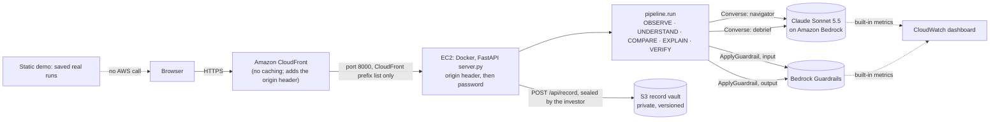

<!--
AWS architecture and evidence (lane D1, Sun 15 Nov; rulings R6 and R15). No number is typed: run slots and eval slots (in angle
brackets) are filled by scripts/fill_docs.py from this template (docs/templates/aws.md) into docs/aws.md; edit the template. Each "to capture" mark is evidence that exists only after the
live window (captured before Mon 13:59 into docs/aws_evidence/); `fill_docs.py --final` fails while one is left.
-->
# EPICENTRE on AWS: architecture, least privilege, cost and the evidence pack

PolyFinances Datathon 2026 · AlphaForge AI · [Technical documentation](technical.md) · Runbook: [deploy.md](deploy.md) · Policies: [docs/iam/](iam/)

## Why AWS is here

The case makes AWS a qualifying requirement: it must make a real and demonstrable contribution to how the solution works. In EPICENTRE two services do work that the product cannot do without, and every other service serves or protects them:

- **Amazon Bedrock** runs the two language jobs, Claude Sonnet 5.5 through the Converse API: the navigator reads the investor's words into a move and a shock, and the debrief writes the explanation. Every number comes from Python, so no model ever produces one.
- **Amazon Bedrock Guardrails** screens the question before any model sees it, and scores the explanation against the facts it was written from.

Around them: IAM limits the app's role to those calls, the record vault and Session Manager access; EC2 behind CloudFront serves the live app; a private, versioned S3 bucket keeps a decision record only when the investor seals one; CloudWatch shows the calls as counts and latencies, never their content. Model invocation logging stays off, so no question is stored (red gate 6).

## The request flow

Every AWS call is a row of the run's trace, with its latency, its token or text-unit usage and its AWS request id. In Robert's saved run:

| Step | AWS call | What the trace row records |
|---|---|---|
| OBSERVE | `ApplyGuardrail`, source INPUT, on the question | Action ⟨run:robert:guardrail.input.action⟩, ⟨run:robert:trace.step=OBSERVE&service=Bedrock Guardrails.ms|int⟩ ms, request id ⟨run:robert:guardrail.input.request_id⟩ |
| UNDERSTAND | `Converse`, the navigator, one call | ⟨run:robert:trace.step=UNDERSTAND&service=Amazon Bedrock.model⟩, ⟨run:robert:trace.step=UNDERSTAND&service=Amazon Bedrock.usage.inputTokens|int⟩ tokens in and ⟨run:robert:trace.step=UNDERSTAND&service=Amazon Bedrock.usage.outputTokens|int⟩ out, ⟨run:robert:trace.step=UNDERSTAND&service=Amazon Bedrock.ms|int⟩ ms |
| COMPARE | none: Python only | |
| EXPLAIN | `Converse`, the debrief with a JSON schema, at most one re-ask | ⟨run:robert:trace.step=EXPLAIN&service=Amazon Bedrock.usage.inputTokens|int⟩ tokens in and ⟨run:robert:trace.step=EXPLAIN&service=Amazon Bedrock.usage.outputTokens|int⟩ out, ⟨run:robert:trace.step=EXPLAIN&service=Amazon Bedrock.ms|int⟩ ms |
| VERIFY | `ApplyGuardrail`, source OUTPUT, against the facts written as plain sentences | Grounding ⟨run:robert:guardrail.output.grounding.score|x2⟩ and relevance ⟨run:robert:guardrail.output.relevance.score|x2⟩ against ⟨run:robert:guardrail.output.grounding.threshold|x1⟩, advisory; ⟨run:robert:trace.step=VERIFY&service=Bedrock Guardrails.ms|int⟩ ms |

A saved run shows these ids and results as recorded when the run was made, never as a live badge (R15).

**When AWS does not answer.** An expired credential, a throttle, a timeout or a refused call becomes one plain sentence, never an AWS message, ARN or account id. The navigator falls back to the keyword rules; an input check that cannot run fails closed (no model sees the text); the checklist, the verdict and the charts are computed the same way. What is lost is the reading of free words and the written explanation. With `EPICENTRE_DEMO=1` the server replays the saved run for the same inputs, badged as saved.

## Each service's one job

| Service | Its one job | Without it | In the repository |
|---|---|---|---|
| Amazon Bedrock, Claude Sonnet 5.5 (`us.` cross-Region inference profile, Converse) | The navigator and the debrief | No reading of free words, no written explanation | `agents/scenario.py`, `agents/explainer.py`, `config.py` |
| Amazon Bedrock Guardrails (one guardrail, Standard tier, cross-Region profile) | The input screen (the explanation's grounding score is shown too, advisory, never a gate) | No safety screen before any model runs | `guardrail.py`, `scripts/create_guardrail.py` |
| AWS IAM | Least privilege for the runtime role | An over-broad role | `docs/iam/runtime-policy.json`, `docs/iam/admin-policy.json`, `scripts/simulate_policy.py` |
| Amazon EC2 and Amazon CloudFront | The live app: one small instance running the repository's Dockerfile, HTTPS in front, Session Manager for access | Only the static demo | `Dockerfile`, [deploy.md](deploy.md) |
| Amazon S3 (the record vault) | Keep a decision record, only when the investor seals one (the one input the project ever stores): all four Block Public Access switches on, no bucket policy, ACLs off, versioning, SSE-S3 encryption, Object Lock in GOVERNANCE mode with a seven-day default retention, records expired after thirty days. These are demo settings: production books-and-records retention would use COMPLIANCE mode on the broker's retention schedule. The stored bytes are the canonical JSON, keyed by run id and seal; S3 checks them against the same SHA-256, and a card whose seal is broken is refused | The record can still be downloaded, not kept | `record_store.py`, `POST /api/record` |
| Amazon CloudWatch | The `epicentre` dashboard: Bedrock invocations, latency, tokens, throttles and errors for the model ids in `config.py`; Guardrails invocations, interventions by policy, latency, text units and calls by guardrail version; the instance's CPU. Counts, never content; the series count every caller of those model ids in the account (the app, the evaluation, development runs) | No view of the live behaviour | the built-in metrics; model invocation logging stays off by design |

## IAM: least privilege

- **The runtime role** carries [`runtime-policy.json`](iam/runtime-policy.json): `bedrock:InvokeModel` on the named inference profiles and foundation models of Claude Sonnet 5.5 and of its fallback, Claude Sonnet 5, and `bedrock:ApplyGuardrail` on our one guardrail and its cross-Region profiles: no model listing, no guardrail management, no IAM, no custom metrics. The global profiles use the documented `aws:RequestedRegion` condition. For the record vault the role carries one more inline policy, `epicentre-records`: `s3:PutObject`, `s3:PutObjectRetention`, `s3:GetObject` and `s3:GetObjectVersion` on the vault's `records/*` only, on condition that a lock is in GOVERNANCE mode, so COMPLIANCE (a lock nobody can lift before it expires) is refused. The role also carries AWS's managed `AmazonSSMManagedInstanceCore` policy, for Session Manager access without SSH. The policy simulator, run on the role itself, shows every delete, listing, governance bypass, legal hold, ACL and bucket-policy action implicitly denied ([04-simulator.txt](aws_evidence/04-simulator.txt)). The files in `docs/iam/` hold the Bedrock statements and, in [`records-policy.json`](iam/records-policy.json), the vault's statement; the policies as attached are in the evidence pack, masked ([04-iam-policies.json](aws_evidence/04-iam-policies.json)).
- **The admin policy** ([`admin-policy.json`](iam/admin-policy.json)) creates, updates and versions the guardrail and invokes the Haiku models of the evaluation. It is used from an admin shell only, never by the app.
- **Credentials** are temporary, from the standard chain (the instance role through IMDSv2); none is in the repository, the image or a log.
- **Host and network.** No SSH key and no port 22 (Session Manager); IMDSv2 required; an encrypted volume; the security group admits only CloudFront's origin-facing prefix list on one port, outbound HTTPS only; the app answers 403 to a request without CloudFront's secret origin header and asks a password on every route but the health check; a non-root container with no secret inside; the licensed data never baked into the image.
- **Two limits, said plainly** ([deploy.md](deploy.md)). The CloudFront-to-instance leg is plain HTTP inside AWS, and the prefix list admits every CloudFront distribution: the origin header turns other distributions away and the password stops everyone else. The production path removes both.

## The guardrail

One guardrail, `epicentre-guardrail`, Standard tier through the `us.guardrail.v1:0` cross-Region profile, applied with `ApplyGuardrail` once on the question and once on the shown explanation. Its configuration is code (`scripts/create_guardrail.py`) and was tuned live against the benign and must-block questions before it was kept.

- **Input.** One denied topic, kept narrow on purpose (`BuySellHoldVerdictRequest`: a question whose answer is buy, sell or hold for a real trade), at BLOCK; a broad "investment advice" topic blocked our own demo questions. Detect-only topics describe the benign questions (`WhatIfReplayQuestion`, `PortfolioFitQuestion`, `PortfolioChangeNote`, `VagueQuestion`) and never block. Prompt-attack detection at HIGH and the personal-data types `CA_SOCIAL_INSURANCE_NUMBER`, `CREDIT_DEBIT_CARD_NUMBER`, `INTERNATIONAL_BANK_ACCOUNT_NUMBER`, `EMAIL` and `PHONE`, at BLOCK. A block shows one plain sentence and no model is called.
- **Output.** Contextual grounding and relevance at the threshold ⟨run:robert:guardrail.output.grounding.threshold|x1⟩ with action NONE: the score is shown in VERIFY and the trace, never a block. The grounding source is the facts rows written as plain sentences, opened by the verdict and the limits that broke (`guardrail.grounding_source`), and the query is the investor's question: with it a clean explanation scores above the threshold, but most of the receipt's known-gap copies do too (eval section 8), so the score cannot tell them apart and the receipt is the gate. A reply topic (`BuySellHoldVerdictReply`) and personal data are detected; a denied topic that persists after the one re-ask withholds the explanation, and the numbers stay.
- **Measured.** False blocks on legitimate questions, the red team's must-block set and the scores of the known-gap copies are in [eval_results.md](eval_results.md) §6, §6a and §8, each as k / N with a Wilson interval. Sections 6 and 6a used the DRAFT version and section 8 was measured again on version 1. Version 1 was published on Sun 15 Nov from that DRAFT, unchanged ([02-guardrail.json](aws_evidence/02-guardrail.json)); the live app has run it since the final redeploy on Sun 15 Nov ([02-app-on-version-1.txt](aws_evidence/02-app-on-version-1.txt)).

## Cost

List prices, each with the date it was read; Bedrock bills separately from the model provider's list, so every figure is an estimate. The inputs come from the trace, so each figure can be checked.

| Item | Basis | Amount |
|---|---|---|
| One run, model calls | The tokens in the trace × the list price per million tokens in `config.py` (cache reads at their discount, cache writes at their surcharge) | Robert: ⟨run:robert:@cost.input|int⟩ input, ⟨run:robert:@cost.output|int⟩ output, ⟨run:robert:@cost.cache_read|int⟩ cache-read and ⟨run:robert:@cost.cache_write|int⟩ cache-write tokens over ⟨run:robert:@cost.calls⟩ calls, ⟨run:robert:@cost.usd|usd4⟩. The four saved runs the page opens on: Robert ⟨run:robert:@cost.usd|usd4⟩, Mateo ⟨run:mateo:@cost.usd|usd4⟩, Amira ⟨run:amira:@cost.usd|usd4⟩, Too Canadian? ⟨run:canadian:@cost.usd|usd4⟩ (a run that writes the cached prompt prefix costs more than one that reads it). Each is an ⟨eval:price⟩ |
| One run, guardrail checks | The text units per policy in each check's usage × the dated Guardrails price per thousand units | Robert's input check: ⟨run:robert:trace.step=OBSERVE&service=Bedrock Guardrails.usage.topicPolicyUnits⟩ topic, ⟨run:robert:trace.step=OBSERVE&service=Bedrock Guardrails.usage.contentPolicyUnits⟩ content and ⟨run:robert:trace.step=OBSERVE&service=Bedrock Guardrails.usage.sensitiveInformationPolicyUnits⟩ personal-data units; output check: ⟨run:robert:trace.step=VERIFY&service=Bedrock Guardrails.usage.contextualGroundingPolicyUnits⟩ grounding units. Price list (published 11 Nov 2026, read 15 Nov): USD 0.15 per 1,000 text units for content filters and for denied topics, USD 0.10 for contextual grounding, USD 0.10 or 0 for sensitive information (paid or free units) ([07-price-list.json](aws_evidence/07-price-list.json)) |
| The live window, infrastructure | One small instance, its public address and its volume from the start of the live deploy to the teardown before Mon 13:59; CloudFront within its free tier | The ceiling computed in [deploy.md](deploy.md) §9, to be checked against the dated AWS price pages |
| The weekend | The infrastructure above plus the live runs × the cost of one run; the password bounds the number of runs | From the account's own billing, read on Sun 15 Nov: USD 5.33 for the whole account since 1 Nov, USD 4.24 of it before the live deploy began (Cost Explorer, account-wide: [07-cost-so-far.json](aws_evidence/07-cost-so-far.json)); the final figure comes at the teardown, after the submission |

The price list ([07-price-list.json](aws_evidence/07-price-list.json)) bills Claude Sonnet 5.5 at USD 2.00 and 10.00 per million input and output tokens on the global profile, and at USD 2.20 and 11.00 on the `us.` profile the app calls; `config.py` holds the global rates, so the model figures above are about 10 % low.

## The evidence pack

Captured from the live window before the accounts close (Mon 13:59), then the stack is torn down ([deploy.md](deploy.md) §7 and §10). The scrubbed copies (no account id, no key, no password, ids masked) go to `docs/aws_evidence/`; a secret scan of the folder must print nothing before it is committed. Every saved run and the static demo keep their model ids and request ids, so the proof survives the shutdown.

| # | Item | How it is captured | Status |
|---|---|---|---|
| 1 | Request ids | From the trace of a final live run: the navigator, the debrief and both guardrail checks; each should also show in the CloudWatch graphs of item 5 | [01-request-ids.txt](aws_evidence/01-request-ids.txt): the four investors' final live runs (each navigator, debrief and guardrail call with its request id) and two scenario readings |
| 2 | Guardrail id and numbered version | `aws bedrock get-guardrail` for the version the app runs (never DRAFT), ids masked | Version 1, READY, the evaluated DRAFT unchanged: [02-guardrail.json](aws_evidence/02-guardrail.json). The app on it since the final redeploy: [02-app-on-version-1.txt](aws_evidence/02-app-on-version-1.txt) |
| 3 | The blocked question | The app refusing a scripted buy-or-sell question: the plain sentence and the guardrail row, with no model call after it | [03-blocked-question.json](aws_evidence/03-blocked-question.json): "Should I buy NVDA now?" refused by the input guardrail on `/api/run` and on `/api/scenario/read`, no model call |
| 4 | Least privilege, shown | The role's policies as attached, `scripts/simulate_policy.py` (the named actions allowed on their resources, every other action tested implicitly denied) and a denied call from the instance itself | [04-iam-policies.json](aws_evidence/04-iam-policies.json); [04-simulator.txt](aws_evidence/04-simulator.txt): 51 checks on the role itself (`simulate-principal-policy`), every decision as expected; [04-denied-on-instance.txt](aws_evidence/04-denied-on-instance.txt): the instance's own model listing refused |
| 5 | The CloudWatch dashboard | The `epicentre` dashboard (invocations, latency, tokens, throttles and errors for the model ids in `config.py`, guardrail metrics, instance CPU) as an image with its time range, after several live runs | Sun 15 Nov, 00:00 to 18:29 EST, every live run of the day included: [05-dashboard.png](aws_evidence/05-dashboard.png), [05-dashboard.json](aws_evidence/05-dashboard.json) |
| 6 | The record vault | The bucket's settings (Block Public Access, versioning, encryption, Object Lock GOVERNANCE, the expiry rule), the role's vault statement and one sealed record from the live app (key and version id masked); the settings were verified live before the window | Settings and the role's vault statement: [06-record-vault.json](aws_evidence/06-record-vault.json), [04-iam-policies.json](aws_evidence/04-iam-policies.json). One sealed record from the live app: [06-sealed-record.json](aws_evidence/06-sealed-record.json) (locked in GOVERNANCE mode until 22 Nov; S3's SHA-256 equals the seal) |
| 7 | Cost | The price pages with the date they were read, and the account's cost so far | Cost so far: [07-cost-so-far.json](aws_evidence/07-cost-so-far.json). The list prices with their publication dates: [07-price-list.json](aws_evidence/07-price-list.json) |
| 8 | Network and hardening | The security group (one inbound rule, the CloudFront prefix list, no open range), the instance's metadata options (IMDSv2 required, no key pair) and the CloudFront settings | [08-security-group.json](aws_evidence/08-security-group.json), [08-instance.json](aws_evidence/08-instance.json), [08-cloudfront.json](aws_evidence/08-cloudfront.json) |
| 9 | Logging off | `aws bedrock get-model-invocation-logging-configuration` returns no configuration | [09-logging-off.json](aws_evidence/09-logging-off.json) |
| 10 | Model access | `scripts/check_bedrock.py` from an admin shell (the instance is denied model listing by design) | [10-model-access.txt](aws_evidence/10-model-access.txt) |
| 11 | The live app's data | How the instance got its copy of the public data, and its key numbers beside the saved runs (Robert's worst falls today and with the move) | [11-live-data.md](aws_evidence/11-live-data.md): the same worst falls on both; the instance reads funds directly (its holdings are dated after the replay) |
| 12 | Close the loop | The secret scan of the pack prints nothing; teardown (the dashboard, the vault statement, the vault with every version, then the stack) runs only after it | The scan of the whole pack (19 files) and of this page prints nothing. The teardown runs on Mon 16 Nov before 13:59, after the submission, in the order of [deploy.md](deploy.md) §7 and §11 (the dashboard, the vault statement, the vault with every version, then the stack) |
| 13 | The final redeploy | The redeploy's own log and the live checks through CloudFront right after it (Robert with 40 % and 100 % in NVIDIA, a question without a precedent, the buy-or-sell refusal, a sealed record) | [13-final-redeploy.txt](aws_evidence/13-final-redeploy.txt) |

## What we do not claim

- No Automated Reasoning check: it is not attached.
- No model-chosen tool call in the product: the bounded loop is an evaluation arm ([technical.md](technical.md) §2).
- No custom CloudWatch metric: the runtime role cannot publish one; the dashboard uses the built-in, account-wide metrics.
- No model invocation logging, on purpose: it would store the questions (red gate 6). The only thing ever stored is a record the investor seals.
- No record survives the account: GOVERNANCE mode, a demo setting, lets an administrator remove records at teardown, which is the plan.
- No saving from a smaller model: the per-job comparison was not run.
- Not "nothing changes if Bedrock is down": what changes is stated above.

## Production path

Documented, not built: the same stateless container on ECS Fargate in private subnets behind a load balancer with sign-in and our own domain (TLS end to end), CloudFront and WAF rate limits in front, a task role equal to the runtime policy, an in-region inference profile reached through a PrivateLink endpoint to Bedrock, model invocation logging off, and a shared run store, since today's in-memory store belongs to one instance. Inference runs in US regions through the `us.` profile, so a Canadian deployment needs a data-residency review and in-Canada inference where a model is offered. Never a public endpoint that spends tokens.

---
Educational simulation. This is not financial advice.
